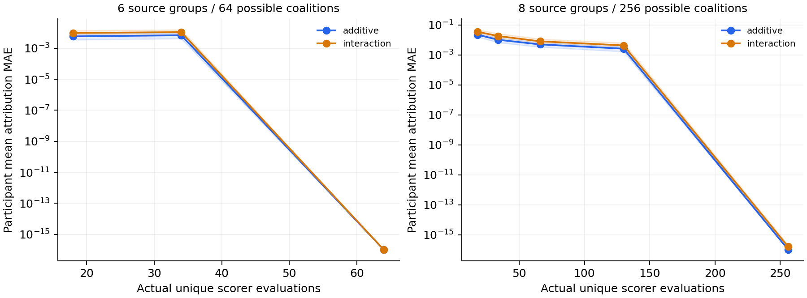

# Q1 Pilot 排序解释问题验证结果

本轮已实际实现并执行。总体判断为 **INCONCLUSIVE**：外部真实排序器与独立参与者验证缺失；在已测试的透明政策范围内，**没有观察到支持新算法的强方法残余失败**。因此不推进由该现象驱动的新算法开发。

## 研究问题与解释范围

检验原始来源一致、目标明确和预算可追溯时，现有解释方法能否计算影响知识相对选择的纵向证据。主目标为 K006−K017 的连续评分差；margin、成对结果、名次、top2 与列表 Kendall 目标分别评价。Shapley Flow 的边游戏单独验证。没有使用 Silver/人工 Gold、付费 API 或训练。

冻结配置 ID：`91c2d19817169f320ad125a7633741e42f97cd80c6624d4b572f78db3f5cb2aa`。原始配置文件 SHA：`b9ccfec06e3d50890be5f02267b79070a01ed4ce942c6086d9c1403e6ef13748`。完整输入发布 ID、权重、阈值、种子、来源分组与 donor 规则见 ../experiments/q1_pilot/config.json 和 protocol.md。

## 样本与完整分母

筛查 16 人、48 窗；纳入 **14 人、38 窗**，排除 10 窗。条件记录计划 3420、实得 3420、失败/阻碍 0；未因方法结果筛选窗口。

| 排除原因 | 窗口数 |
|---|---:|
| INSUFFICIENT_BASELINE_SLEEP_CLOCK | 6 |
| INSUFFICIENT_CURRENT_SLEEP_CLOCK | 4 |

固定候选对 1 个。P1 保留 5 候选，A1 duration_and_timing 保留 4 候选；A1 26 条知识没有全部跑遍。两策略各 38 次 donor 分配，共 76 个不同真实七日块；每条件只有一个背景周，重复映射至 42 日，不能当六个独立 donor。

拼接诊断：一侧接缝睡眠跳变最大 375 分钟；可用睡眠覆盖差范围 [-10, 17] 日。所有模态/缺测/质量随整块替换，目标日号、星期和 phase 保留。真实周的周期性复用与接缝自然性未获生理验证，这些结果不能视为真实生活干预。

## 评分器行为先验收后解释

F-Additive 只在声明的统计特征上加权；F-Interaction 增加 short×gap、clock×adjacent 与有序趋势项。两者都是手写实验政策，不是两个独立真实模型；420 分钟等常数只是实验政策参数。原 null 保持 null；统计缺失映射到显式中性政策特征并另保留覆盖。零 RHR 排除，非零/未知 sleep infoCode 的睡眠不进入生理特征。

| 政策 | 控制 | 有响应窗 / 纳入窗 | 成对顺序变化 | Top1 变化 | Top2 变化 |
|---|---|---:|---:|---:|---:|
| additive | history_minus60 | 38/38 | 5 | 5 | 4 |
| additive | current_minus60 | 38/38 | 20 | 20 | 21 |
| additive | clock_alternating | 38/38 | 8 | 9 | 0 |
| additive | reverse_current | 0/38 | 0 | 0 | 0 |
| additive | unused_context | 0/38 | 0 | 0 | 0 |
| interaction | history_minus60 | 38/38 | 4 | 4 | 7 |
| interaction | current_minus60 | 38/38 | 14 | 14 | 20 |
| interaction | clock_alternating | 38/38 | 4 | 4 | 0 |
| interaction | reverse_current | 38/38 | 1 | 1 | 3 |
| interaction | unused_context | 0/38 | 0 | 0 | 0 |
| item_only | history_minus60 | 0/38 | 0 | 0 | 0 |
| item_only | current_minus60 | 0/38 | 0 | 0 | 0 |
| item_only | clock_alternating | 0/38 | 0 | 0 | 0 |
| item_only | reverse_current | 0/38 | 0 | 0 | 0 |
| item_only | unused_context | 0/38 | 0 | 0 | 0 |

上述人工变化是机制检查，不保证生理可行。reverse_current 保留当前期值的集合及均值/波动，改变顺序；加性 margin 应不变，交互政策可以响应趋势。未使用 context 字段和 item-only 全部检查不变性。行为表 top-k 采用分数后候选 ID 确定性打破 ties；独立 top2 QoI 则采用竞争名次、边界 ties 全纳入，二者没有混算。

## 方法的真实运行状态

| 方法 | 官方固定提交 | 原生验证 | 任务执行与偏离 |
|---|---|---|---|
| RankingShap | `36e45975f34ee167261af56c69521d55c998b282` | NATIVE_REPRODUCED | TASK_ADAPTED_AND_RUN：官方共同遮蔽与 KernelSHAP；来源选择器和 margin callback；列表 Kendall 另报 |
| ShaRP | `6543226b7c4952aab61a15a977964344cabbf929` | NATIVE_REPRODUCED | TASK_ADAPTED_AND_RUN：官方 _shapley 与 diff QoI；完整个人管线 margin/结果/名次/top2 wrapper，不冒称原生 item-row 偏好 |
| Shapley-Flow | `0d9063f81759d4317de6c33d7782e5ec4a4cde85` | NATIVE_REPRODUCED | TASK_ADAPTED_AND_RUN：官方 CreditFlow；已知计算 DAG，三条合法切边与节点守恒；不与节点 SHAP 做误差排名 |
| TimeSHAP | 未获取 | BLOCKED | 可选项本轮未实现、未运行，不能视为已完成强基线覆盖 |
| 外部真实排序器 | 无 | BLOCKED_EXTERNAL_RANKER_VALIDATION | 两种手写政策不能补足此项 |

原生验证分别执行作者 talent-search notebook、ShaRP plot_basic_usage 的数值工作流及 Flow sample_build_graph。只证明最小原生实现执行，不等于完整论文数据/指标复现。第三方源码跟踪文件未改；依赖 lock 与每次 manifest 保存实际环境。

## 同一游戏上的数值结果

| 方法与目标 | 完整预算记录数 | 参与者平均 MAE | 最大单项归因误差 | 最大效率残差 |
|---|---:|---:|---:|---:|
| RankingSHAP | 608 | 8.46e-17 | 1.67e-15 | 1.33e-15 |
| ShaRP | 304 | 4.62e-17 | 1.78e-15 | 2.22e-15 |
| RankingSHAP_listwise | 76 | 1.07e-17 | 1.21e-16 | 1.11e-16 |
| ShaRP_outcome | 228 | 1.93e-17 | 1.33e-15 | 1.33e-15 |

这些行分别使用各自目标的精确参考，**不构成跨目标方法排名**。margin 为主评价；pair/negative_rank/top2/Kendall 的参考与 margin 的参考不能互换。完整逐条件、按人 bootstrap 的 95% 区间、参与者范围见公开 summary-v1.json 的 aggregate_metrics。

| 政策 | 主 donor 来源替换窗 | 成对顺序改变 | Top1 改变 | Top2 改变 | Margin 变化范围 |
|---|---:|---:|---:|---:|---|
| additive | 38 | 3 | 4 | 6 | [-1.76, 3.29] |
| interaction | 38 | 3 | 3 | 6 | [-2.76, 7.2] |

共 342 个来源游戏精确枚举；6 组 64 coalition、8 组 256 coalition。主 donor 周在 foreground 的对应 baseline 块上可能完全相同，因而该来源可以是 dummy；不能把名义维度当有效独立因素数。

## 预算与敏感性

RankingSHAP 的 nsamples 不含背景/前景；图横轴使用实际唯一端到端 scorer 调用，冷缓存按方法/种子/预算独立重建。6 组预算 16/32/62，8 组 16/32/64/128/254；满枚举以后没有伪称更高预算带来更精细近似。曲线阴影是参与者 bootstrap 区间，低预算种子为 0/1/2。

交互政策的预算明细如下；MAE 是先按人平均再汇总，种子为 0/1/2。6 组从 16 到 32 的有限采样并非单调改善，不能据此认定结构缺陷。图中低于 1e-16 的值仅为显示截至 1e-16，精确值见前表。

| 来源组数 | Kernel nsamples | 实际唯一 coalition / scorer 计算 | MAE | 非零参考符号一致率 | 主要来源命中率 |
|---|---:|---:|---:|---:|---:|
| 6 | 16 | 18 | 0.00976 | 0.980 | 0.988 |
| 6 | 32 | 34 | 0.0109 | 0.959 | 0.988 |
| 6 | 62 | 64 | 6.11e-17 | 1.000 | 1.000 |
| 8 | 16 | 18 | 0.0354 | 0.766 | 0.944 |
| 8 | 32 | 34 | 0.0183 | 0.928 | 0.921 |
| 8 | 64 | 66 | 0.00814 | 0.981 | 0.964 |
| 8 | 128 | 130 | 0.00434 | 0.986 | 0.984 |
| 8 | 254 | 256 | 1.64e-16 | 1.000 | 1.000 |

已运行最早/最近两个本人基线 donor 策略、6/8 组粒度和 A1 面板扩展。它们共享参与者，不增加独立样本数。A1 主 margin 的权重不依赖候选全集，所以此扩展不能证明候选集合依赖机制已被检验。多背景期望、条件分布和跨参与者 donor 都未执行。

主运行端到端 scorer 实际计算 245821 次，查询请求 743508 次；方法计算累计 419 秒，运行约 455 秒。独立派生坐标政策评估另有 58368 次；前置行为控制另有 684 次。官方原生 smoke 的时间单独记录，未把其调用混入健康预算曲线。

## 图归因与独立诊断

canonical Flow 覆盖 14 人、38 窗、76 个政策条件，每条件 64 次 timeline，另独立重建图重复一次；固定 seed 边归因一致：True。最大切边守恒残差 6.66e-15，节点守恒残差 5.33e-15。

该补充运行含 9576 次端到端 raw pipeline 计算、272384 次全候选评分节点评估。节点内重算和解释器调用不同，不能把它与 KernelSHAP 按同一函数调用数量直接排效率。原生小 DAG 另用官方精确 divide_and_conquer 与 boundary_graph 检查切边一致性：x、z 贡献分别为 3、2，折叠边界后保持一致。真实图本轮主要验证守恒，不据此声称全部边分配具有外部正确性。

新增 456 个逐块 +30 分钟数值探针，444 个 margin 响应、22 个成对顺序改变。它们独立于二元 Merge 游戏，属于额外软件诊断而非预注册确认性证据，不要求另一种 game 的 Shapley 值预测其影响。

原逐块删除诊断复用了精确枚举中的 coalition，故**不是独立留出评价**；只报告描述统计，不能用于泛化主张。派生坐标负对照则在自己的 9 特征/512 coalition 游戏中检验效率，不计算它相对原始来源归因的 MAE；差异首先属于估计对象不同。

## 正反例与失败归因

阳性控制：仅改变历史或近期观测均能改变政策 margin，部分变化跨越真实政策排序边界；因此解释对象确实利用纵向输入。阴性控制：item-only 的来源归因全零；未使用字段改变不影响输出。加性/交互解析性质、dummy、对称性、效率、来源置换、未来 donor 拒绝与联合重算均有数值测试。

除主运行的精确 item-only 参考外，补充运行 `negative-controls-v1` 还在全部 38 窗上分别执行 RankingSHAP、ShaRP、Shapley Flow，共 114 条官方方法负对照记录。三个方法的最大绝对归因均为 0；没有失败。独立资源开销为 7,258 次 raw scorer 计算、124,222 次查询请求，以及 Flow 的 68,096 次全候选评分节点评估；公开聚合为 negative-controls-v1.json。

发现并排除的接口问题：RankingSHAP 官方 constructor 以零占位预测器建立 fnull，随后才换 query 模型。测试中真实背景值 2、前景值 3，未修复会把归因总和算成 3；适配器按真实 query 重新初始化官方 KernelExplainer 后，正确解释差值 1。属于第 2 类接口问题。原始官方源码未修改，修复前测试与日志保留。

另一个可重放性问题：Flow Graph 将节点放入 set，有限 Monte Carlo 的抽样顺序会依赖对象遍历。adapter 只规范输入节点次序；full-v1 旧实现与结果有独立源码快照，canonical 补充运行没有覆盖它。

低预算与精确参考的差异归为第 5 类采样/预算；独立派生列与原始来源的差异归为第 4 类 estimand 不同；周块平铺的自然性风险归为第 6 类背景限制。没有在排除前述因素后建立第 7 类算法/结构残余失败。来源字节与历史资产校验不能代替医学来源语义确认。

## 不确定性与边界

统计按参与者先求均值再 bootstrap，重复 1000 次；没有把窗口、候选或 coalition 当独立人。仅 14 位纳入参与者且都曾暴露于历史研究，不能作新队列确认。没有学习/LLM 排序器、多样外部背景、时间模态扩展、真实优先级标签或临床结果。精确参考是本研究声明游戏的程序真值，不是医学最优推荐。

## Gate 1 与 Gate 2 决策

**Gate 1：测试范围内未观察到强方法残余失败。** 同游戏满预算结果达到浮点精度；低预算误差、接口背景偏移、跨游戏差异与 donor 自然性不能作为算法失效证据。Flow 守恒通过也不等于证明所有边归因外部有效。

**Gate 2：没有支持新算法必要性的证据。** 联合重算和现有官方方法已经解决本轮可测的数值解释问题。当前结论不足以提出新算法或 SIGIR 创新。整体仍为 **INCONCLUSIVE**，因为本轮只有透明政策，外部真实排序器未验证。下一轮不推进新算法开发；只有要检验外部有效性时，才有理由另行扩展到独立真实排序器、未接触参与者和更自然的背景分布。

## 执行记录与复现

主运行：`local/experiments/q1_pilot/full-v1/`；补充运行：`local/experiments/q1_pilot/flow-canonical-v1/`。两处私有 records、manifest 和 stdout/stderr 均保留；公开目录只有配置、源码、依赖锁、聚合 JSON 和聚合图。来源：官方 [RankingSHAP](https://github.com/MariaHeuss/RankingShap)、[ShaRP](https://github.com/DataResponsibly/ShaRP)、[Shapley Flow](https://github.com/nathanwang000/Shapley-Flow)。

改动前检查为 q1-preflight-v1；最终测试与含旧项目的校验记录由本次 final 检查独立保存。检查数量与退出码见 VALIDATION_Q1.md。旧迁移报告未回写。
